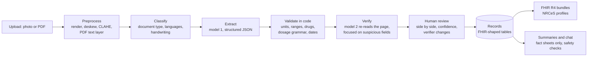

# Health Copilot: full documentation

The [README](README.md) is the overview. This document covers everything needed to run, configure, deploy, test and
extend Health Copilot.

**Contents**

1. [Features in detail](#1-features-in-detail)
2. [How the pipeline works](#2-how-the-pipeline-works)
3. [Running locally](#3-running-locally)
4. [Accounts, email codes and notifications](#4-accounts-email-codes-and-notifications)
5. [Demo data and maintenance commands](#5-demo-data-and-maintenance-commands)
6. [Deploying: AWS (the live site) or Render](#6-deploying-aws-the-live-site-or-render)
7. [Configuration reference](#7-configuration-reference)
8. [Tests and evaluation](#8-tests-and-evaluation)
9. [Project layout](#9-project-layout)
10. [Safety, privacy and security](#10-safety-privacy-and-security)
11. [Credits](#11-credits)

---

## 1. Features in detail

- **Ingest:** drag and drop, or use the phone camera. PDF, JPG, PNG and WEBP are accepted, multi-page documents
  included. Printed, handwritten, bilingual and regional-script documents all work. An upload can be deleted while
  it is being read or before it is reviewed; reading stops and its files are removed.
- **Extract:** medicines with strength, dose, a morning/afternoon/night schedule, meal timing and duration; test
  values with units and reference ranges; diagnoses with ICD-10 codes; vitals; dates; doctor and facility.
- **Verify:**
  - A second model re-reads the page, guided by the validators' suspicious fields.
  - Code checks units, ranges, flags, drug names, dosage grammar, dates and plausibility.
  - A person confirms every document on a side-by-side review screen before anything is saved.
- **Explain:** plain-language summaries that cover what each abnormal result may mean, questions to ask the doctor,
  the medicine schedule and a glossary. They pass safety checks: no dosing advice, no diagnosis, and every number
  must come from the record. They are translated into Hindi, Telugu, Tamil or Kannada with all numbers preserved.
- **Unified profile:** dashboard, timeline, trends with shaded reference ranges, active and past medicines, and
  critical-value banners. A newer prescription of the same drug automatically supersedes the older one.
- **Ask my records:** chat grounded only in the patient's own records, with citations, voice input and read-aloud,
  automatic reply language, and emergency detection.
- **Medicine reminders (copilot):** confirming a prescription schedules a reminder for every regular medicine at the
  prescription's own times: morning 08:00, afternoon 14:00, night 21:00, 30 minutes earlier for "before food",
  07:00 for empty stomach and 22:00 for bedtime. Each reminder ends with the course (a "for 5 days" medicine stops on
  day 5), SOS and STAT medicines are never scheduled, and a newer prescription of the same drug replaces the old
  reminder. The **Reminders** page shows the day for one person or the whole family: **Taken**, **Snooze 15 min**,
  **Skip** and **Undo** for every dose, missed doses after 2 hours, 7-day adherence, and editing of times, pause,
  resume, stop or delete. Reminders arrive as phone or desktop notifications (Web Push, with Taken and Snooze buttons
  on the notification itself) and as an in-app card when a dose is due.
- **Visits and tests:** follow-ups in the doctor's notes ("Review after 1 month with fasting sugar report", "Repeat
  HbA1c after 3 months", dates such as 12/11/2026) become dated visits and tests, with a notification the
  evening before and on the morning. They can be marked done, edited or added by hand.
- **Health insights:** computed in code from the person's own results, never by the model, and each one cites the
  results it is based on (test, value, date, source record):
  - *trends:* a value outside the range in 2 or more consecutive reports, still rising or falling the wrong way,
    nearing its limit, critical, or improving;
  - *combinations doctors look at together:* sugar with LDL, triglycerides with low HDL, the iron-deficiency pattern
    (Hb, MCV, ferritin), B12, kidney results with diabetes or BP (and metformin), thyroid on treatment, liver
    enzymes with metabolic risk;
  - *preventive next steps:* repeat tests that are due or overdue (HbA1c every 3 months when above target, lipids,
    kidney, CBC, thyroid, vitamin D, B12, liver, uric acid), unless a visit or test is already planned for it, and
    screenings for the person's age, sex and conditions (diabetic eye, foot and urine ACR checks, home BP, NPCDCS
    screening from 30, cervical and breast screening, colon from 50, bone density, flu vaccine, eyes and hearing
    from 60). Everything is worded as something to discuss with the doctor.
- **Wellness plan:** diet, activity, sleep and habit tips chosen for the person's results, conditions and age, each
  with the reason in their own data (for example, "your HbA1c went 7.4% → 7.9% → 8.6%"). Indian food context and
  general wellness only: no diets, supplements or medicine changes.
- **Copilot actions (agentic, with you in control):** after each confirmed document the copilot acts on its own and
  shows what it did: reminders scheduled or stopped, follow-ups and repeat tests added, and three questions drafted
  for the next visit from the latest results. A daily check also flags overdue follow-ups and repeat tests that are
  due. Every action can be **kept**, **edited**, **undone** (removes the reminders or appointment it created) or
  **dismissed**, and suggestions can be accepted (adds the test to Reminders) or marked done. The **visit sheet**
  is a printable page with the questions, current medicines, results to discuss and tests due.
- **Family:** one account holds the account holder's own profile plus any number of family members, each with their
  own records. The account holder adds, edits or removes members on the **Family** page.
- **Your account:** the three-dot menu at the top right shows who is signed in and opens **Your account** (name, mobile
  number, email, password, notifications, delete account) and **Sign out**, which asks for confirmation first.
- **ABDM readiness:**
  - Every document becomes an NRCeS-profile FHIR R4 bundle, and the whole record exports as one bundle.
  - Mock ABHA flow: link with OTP, consent artefact, and import from a mock Health Information Provider.
  - A readable view of each bundle (patient, practitioner, results, medicines, conditions, codes), with the raw JSON
    one click away.
- **Languages:** the 12 most-spoken Indian languages plus English: Hindi, Bengali, Marathi, Telugu, Tamil, Gujarati,
  Urdu (right to left), Kannada, Odia, Malayalam, Punjabi and Assamese. Each person's profile has its own language,
  used for summaries, chat replies, voice, reminders, insights and notifications, so a parent can use Telugu while
  the account holder uses English. Only English is in the main bundle; other languages load when first chosen.
- **Voice:** ask by voice and hear the answer, in the profile's language (the browser's recogniser and voices where
  available, the server's speech models otherwise). Ask "What medicines do I take tonight?" in Telugu: the chat
  knows the reminder times and answers from today's schedule. Built to feel quick:
  - the microphone listens in each family member's own language, lets slow speakers pause mid-sentence, and ends
    the turn about a second after they stop (the recording fallback adapts its threshold to the room's noise);
  - spoken questions get a short spoken-style answer (1-3 sentences, no tables) with minimal model thinking, and the
    answer is read aloud automatically;
  - chat, voice and translation calls never wait on a struggling model: each model gets one try, a slow one is raced
    by the next after 6 seconds, the first answer wins, and overloaded models are skipped for a while;
  - server read-aloud starts with the first sentence while the rest is generated;
  - if every model is busy or out of quota, "which medicines tonight / this morning / today?" is still answered
    instantly from the reminder schedule, in any of the 13 languages.
- **Interface:** light and dark themes (the system theme is followed until the user picks one).
- **On phones:** a compact header, a bottom tab bar (Home, Today, Upload, Ask, More) and layouts that fit screens
  from 360 px wide. The site can be installed to the home screen as an app (web app manifest and icons).

**Measured accuracy** ([`eval/report.md`](eval/report.md)): on 10 synthetic documents with 96 items, the pipeline
with verification got 100% of 477 checked fields right; the single pass got 99.8%. The test set covers printed,
handwritten, phone-photo, PDF, Hindi, Telugu, Tamil and Kannada documents. This is a regression suite, not a
clinical validation; see the report for caveats.

## 2. How the pipeline works



- **Models:** each role (extract, verify, fast) has a fallback chain of models. The first available one wins, and
  quota or overload errors move to the next. Verification deliberately starts on a different model from extraction.
- **Deterministic decisions:** High, Low and Critical flags, unit conversions, LOINC and ICD-10 codes and medicine
  schedules are computed in code from a curated knowledge base (60 lab tests, 213 Indian drug brands, dosage terms).
  The models read the page and write prose; they never decide what is abnormal.
- **Reference ranges:** the report's own range is used when it has one; if a report prints several bands, the one
  for the patient's sex (or the normal band) is chosen; otherwise the curated range applies.

The same flow as a request sequence, from upload to confirmed records:


[`docs/architecture.md`](docs/architecture.md) has the full design.

## 3. Running locally

Requirements: Python 3.12, Node 22, and a [Gemini API key](https://aistudio.google.com/apikey). OpenAI also works.

### With the control script

`run.sh` runs both servers in the background, with logs in `.run/`:

```bash
./run.sh setup                 # first time: system packages, virtualenv, pip and npm install, backend/.env
./run.sh start                 # backend :8000 + frontend :5173
./run.sh status
./run.sh restart [backend|frontend]
./run.sh logs [backend|frontend]
./run.sh stop
HOST=0.0.0.0 ./run.sh start    # open from a phone on the same Wi-Fi (camera upload)
```

`setup` also installs what the system is missing, as far as possible without touching the system:

- **Node 22:** uses an existing Node 20.19+/22.12+ (including nvm or volta installs); otherwise downloads the
  official build from nodejs.org into `.tools/node`.
- **Python 3.11–3.13 with venv:** uses the system Python; otherwise installs [uv](https://docs.astral.sh/uv/) in
  `~/.local/bin` and uses a standalone Python 3.12.
- **lsof, curl, python3-venv:** installed with apt when missing (asks for your sudo password).

It also works with `sudo ./run.sh setup`: only the apt packages are installed as root, and the project files stay
owned by you.

After a `git pull`, just run `./run.sh restart`: start and restart first install any packages added to
`backend/requirements.txt` or `frontend/package-lock.json` since the last install.

### By hand

```bash
# backend
cd backend
python3 -m venv .venv && .venv/bin/pip install -r requirements.txt
cp .env.example .env            # then put your key in GEMINI_API_KEY
.venv/bin/uvicorn app.main:app --port 8000 --reload --reload-dir app

# frontend (second terminal)
cd frontend
npm install
npm run dev                     # http://localhost:5173 (proxies /api to :8000)
```

### With Docker

```bash
cp backend/.env.example backend/.env   # add your key
docker-compose up --build              # http://localhost:8080 (Postgres + backend + nginx frontend)
```

The root `Dockerfile` builds the single-container image used on Render: the API also serves the built website.

### Behind a TLS-inspecting corporate proxy

If HTTPS calls fail with certificate errors, for example behind Zscaler:

- **Backend:** point `CA_BUNDLE` in `backend/.env` at a PEM file that contains the system CAs plus the proxy's root CA.
- **npm:** set `NODE_EXTRA_CA_CERTS=/path/to/proxy-root.pem`.

## 4. Accounts, email codes and notifications

### Accounts

- **Sign-up** takes a first name, a last name, an email address, an optional mobile number and a password. The account
  is created only after the 6-digit code emailed to that address is entered.
- **Sign-in** takes the email or the mobile number, with the password. A mobile number (any of 20 countries, India by
  default) can be added at sign-up or later under **Your account**; each number belongs to one account.
- **Isolation:** each account sees only its own profiles and documents; requests for another account's records
  return 404.
- **Sessions and passwords:** an HttpOnly cookie (30 days), scrypt password hashes, and throttling of repeated
  wrong passwords.
- **Older accounts** created before email verification see a reminder on the dashboard to add and verify an email.

### Email codes

- Codes are 6 digits, expire after 10 minutes and allow 5 tries. A new code of the same kind can be requested after
  60 seconds, and at most 5 codes are sent to one email per hour. Only a hash of each code is stored.
- **Forgot password** emails a code to the account's verified email and then signs out every device. The reply is the
  same whether or not the account exists.
- **Changing the email** needs the current password and a code sent to the new address; the old address is told.
- **Locally**, without an email provider, the code is shown on screen instead of being emailed. A server with
  `COOKIE_SECURE=true` never does this: it refuses to send codes until email is set up.
- SMS codes aren't used: no SMS provider is free, so mobile numbers aren't verified by text.

### Notifications

Each can be turned off under **Your account**. All need a verified email.

- **Security alerts:** new sign-in (with the browser and device), password changed or reset, email changed.
- **Dose reminders (push):** each device that turns on **Get reminders on this device** (Reminders page or
  dashboard) gets a Web Push notification at every dose time, in the person's language, with **Taken** and **Snooze
  15 min** buttons. A dose is announced once, up to 45 minutes after its time; a snoozed dose is announced again when
  the snooze ends. Visits and tests are announced at 18:00 the day before and 08:00 on the day. No email is needed.
  On iPhone, push works after adding the site to the Home Screen.
- **Course-ending emails:** when a course with a known duration ends within 2 days or ended in the last 3. Each course
  is reminded about once.
- **Weekly summary:** per family member, new records, results outside the usual range and active medicines.

Push notifications come from a scheduler inside the web process (it checks every 30 seconds). It also runs the daily
copilot check and the email job at 9 AM IST. On Render, which sleeps, the GitHub Action below wakes it instead (see
[the deploy section](#daily-reminders-and-weekly-summaries)). Emails are in English.

## 5. Demo data and maintenance commands

The Round 2 demo family (no LLM calls) shows every feature on realistic records:

```bash
cd backend && .venv/bin/python -m app.demo          # resets the demo account demo@healthcopilot.in / demo12345
docker exec health-copilot python -m app.demo       # the same on the server
```

- **Ravi Kumar** (36, English): a fever prescription from 3 days ago with a 5-day antibiotic, so the copilot has just
  scheduled reminders that end with the course and drafted questions.
- **Ramesh Kumar** (father, 64, Hindi): three reports over nine months with HbA1c 7.4% → 7.9% → 8.6%, rising LDL and
  creatinine, a diabetes prescription, an overdue follow-up and an overdue repeat HbA1c.
- **Lakshmi Kumar** (mother, 59, Telugu): low haemoglobin and ferritin, high TSH and low vitamin D, on thyroid, iron
  and calcium tablets with bedtime and empty-stomach times.

A week of dose history (with a few missed doses) gives the adherence figures. It uses the same confirm path as real
uploads, so the reminders, appointments and copilot actions are created by the agent itself.

The original Round 1 demo is still available. To load a demo account (`demo@healthcopilot.in`, password `demo12345`) with a patient, an ABHA link and a year of
records (no LLM calls needed), against a local backend:

```bash
backend/.venv/bin/python scripts/seed_demo.py
# optionally also run real documents through the pipeline:
backend/.venv/bin/python scripts/seed_demo.py --confirm lab_diabetes_lipid_pdf,rx_handwritten_diabetes --review rx_handwritten_photo
# use your own account instead:
backend/.venv/bin/python scripts/seed_demo.py --login you@example.com --password '...'
```

The demo ABHA OTP is `123456`.

Profiles created before accounts existed have no owner and are hidden. Give them to an account with:

```bash
cd backend && .venv/bin/python -m app.manage accounts                      # list accounts and profiles
cd backend && .venv/bin/python -m app.manage assign-orphans demo@healthcopilot.in
```

## 6. Deploying: AWS (the live site) or Render

### On AWS (free tier), the live site

The live site, [healthcopilot.duckdns.org](https://healthcopilot.duckdns.org), runs on one always-on EC2 instance,
so the reminder scheduler and push notifications work without any outside timer.

| Piece | Service | Role |
|---|---|---|
| Server | EC2 `t3.micro` (free tier), Ubuntu 24.04, 30 GB gp3, 2 GB swap | Runs the Docker container |
| Address | Elastic IP + [DuckDNS](https://www.duckdns.org) name | A fixed, free domain name |
| HTTPS | [Caddy](https://caddyserver.com) | Let's Encrypt certificate and reverse proxy |
| Data | Docker volume `hc-data` | SQLite database, uploaded files and the push (VAPID) key |

1. **Launch the instance:** EC2 → Launch instance, Ubuntu 24.04, `t3.micro`, a new key pair, 30 GB gp3. In the
   security group, allow SSH from your IP, and HTTP (80) and HTTPS (443) from anywhere. Allocate an **Elastic IP**
   and associate it with the instance.
2. **Name it:** sign in to DuckDNS, create a subdomain (for example `healthcopilot`) and set it to the Elastic IP.
3. **Prepare the server** (`ssh -i key.pem ubuntu@<elastic-ip>`):

   ```bash
   sudo fallocate -l 2G /swapfile && sudo chmod 600 /swapfile && sudo mkswap /swapfile && sudo swapon /swapfile
   echo '/swapfile none swap sw 0 0' | sudo tee -a /etc/fstab
   sudo apt update && sudo apt install -y docker.io caddy git
   sudo usermod -aG docker ubuntu     # then log out and back in
   ```

4. **Configure and run the app:**

   ```bash
   git clone https://github.com/prasanthselam-arch/health-copilot.git && cd health-copilot
   cat > ~/hc.env <<EOF
   GEMINI_API_KEY=...
   COOKIE_SECURE=true
   APP_URL=https://healthcopilot.duckdns.org
   CRON_SECRET=$(openssl rand -hex 24)
   WORKER_THREADS=1
   EOF
   chmod 600 ~/hc.env
   docker build -t health-copilot .
   docker run -d --name health-copilot --restart unless-stopped --env-file ~/hc.env \
     -p 127.0.0.1:10000:10000 -v hc-data:/app/backend/data health-copilot
   ```

   Port 10000 is bound to localhost, so only Caddy can reach it.
5. **Turn on HTTPS:** put this in `/etc/caddy/Caddyfile`, then run `sudo systemctl reload caddy`:

   ```
   healthcopilot.duckdns.org {
       reverse_proxy 127.0.0.1:10000
   }
   ```

6. **Load the demo family:** `docker exec health-copilot python -m app.demo`.

**Updating:** `git pull && docker build -t health-copilot . && docker rm -f health-copilot`, then the same
`docker run` command. The data volume is kept.

### On Render (free alternative)

Everything runs on free plans:

| Piece | Free service | Role |
|---|---|---|
| Web app | Render free web service (Docker) | API and website in one container |
| Data | A private GitHub repository | Database and uploaded files, restored at start-up |
| Email | Google Apps Script on your Gmail | Codes, alerts, reminders (about 100 a day) |
| Checks and timers | GitHub Actions | Tests before each deploy, daily notification job |

### How the data survives

A free Render service has no persistent disk: it forgets everything when it restarts, redeploys or sleeps after 15
minutes without traffic. So at start-up the app restores its SQLite database and files from the private data
repository, and pushes a snapshot back about a minute after anything changes and again when it shuts down. Each day
keeps one commit, so the repository also gives you a daily history.

- The token is passed to git through environment variables only. It is never written to a URL, a file or the logs.
- If the data repository can't be read at start-up (wrong name, expired token), the app still starts but stops
  syncing, so an empty instance can never overwrite your data. The Render logs say so; fix the variable and redeploy.
- During a redeploy, if the old and new instances both push, no snapshot is lost: the newer one is stacked on top.
- A change made in the last minute before a crash (not a normal stop) can be lost. Normal stops, redeploys and sleep
  always push a final snapshot.
- Keep the data repository private: it contains everyone's health records.

### Steps

1. **Create the data repository.** On GitHub, create a new **private**, empty repository, for example
   `your-name/health-copilot-data` (no README or licence).
2. **Create a token for it.** In GitHub **Settings → Developer settings → Personal access tokens → Fine-grained
   tokens**, generate a token with **Repository access: Only select repositories** (pick the data repository) and
   **Permissions → Contents: Read and write**. Choose an expiry date and put a reminder in your calendar to renew it.
3. **Create the service.** In Render, choose **New → Blueprint**, connect this GitHub repository and pick the
   `main` branch. Render reads `render.yaml` and asks for:
   - `GEMINI_API_KEY`: your Gemini API key;
   - `DATA_REPO`: the data repository as `owner/name`, for example `your-name/health-copilot-data`;
   - `DATA_REPO_TOKEN`: the token from step 2.
4. **Deploy.** The first build takes a few minutes. The site is then at `https://health-copilot-<id>.onrender.com`,
   and every push to `main` redeploys it once the GitHub Actions checks (`.github/workflows/ci.yml`: backend
   tests, frontend lint and build) pass. A push that fails them is not deployed; the live site keeps running.

### Email through Google Apps Script

Render's free plan blocks SMTP, so Gmail can't be used directly. Instead, a small script on your Google account sends
the emails from your Gmail, and the app reaches it over HTTPS with a shared secret:

1. In Render, open the service's **Environment** tab and copy the generated `GOOGLE_SCRIPT_SECRET` value.
2. Signed in to the Gmail account that should send the emails, open [script.google.com](https://script.google.com),
   choose **New project**, replace the code with [`scripts/google-apps-script/Code.gs`](scripts/google-apps-script/Code.gs)
   and save.
3. Open **Project Settings** (gear icon) → **Script properties** → **Add script property**: name `SECRET`, value
   from step 1. Save.
4. **Deploy → New deployment**, pick type **Web app**, set **Execute as: Me** and **Who has access: Anyone**, then
   **Deploy**. Allow access when Google asks (it's your own script: **Advanced → Go to … (unsafe)** is expected).
   Copy the **Web app URL** (it ends in `/exec`).
5. Back in Render's **Environment** tab, add `GOOGLE_SCRIPT_URL` with that URL and save.

Until this is done, the live site can't send codes, so sign-up and password reset show "Email isn't set up on this
server yet". If you edit the script later, use **Deploy → Manage deployments → Edit → New version** so the URL stays
the same.

### Daily reminders and weekly summaries

A sleeping free service runs no timers, so the scheduled GitHub Action `.github/workflows/notify.yml` wakes it every
day at 9 AM IST and runs the job. To turn it on, copy the `CRON_SECRET` value Render generated (service
**Environment** tab) and, in the GitHub repository's **Settings → Secrets and variables → Actions**, add it as the
secret `CRON_SECRET` and add the variable `APP_URL` with the site's address (for example
`https://health-copilot-kl7g.onrender.com`). Run it once by hand from the **Actions** tab to check. GitHub pauses
scheduled workflows after 60 days without commits; re-enable it from the Actions tab if that happens.

### Limits to know

- The first visit after the service has slept takes about a minute while Render starts it again.
- The Gemini free tier allows only about 20 requests per model per day. One document uses 3 requests (classify,
  extract, verify), and each summary or chat answer uses one or two more.
- Gmail sends about 100 emails a day through Apps Script.
- GitHub warns about repositories over 1 GB and rejects files over 100 MB, which is far beyond a demo's needs.

## 7. Configuration reference

All settings are environment variables, read from `backend/.env` locally (see
[`backend/.env.example`](backend/.env.example)) and from the service's environment on Render.

| Variable | Default | Notes |
|---|---|---|
| `LLM_PROVIDER` | `gemini` | `gemini` or `openai` |
| `GEMINI_API_KEY` / `OPENAI_API_KEY` | — | Required for extraction, summaries and chat |
| `GEMINI_EXTRACT_MODELS`, `GEMINI_VERIFY_MODELS`, `GEMINI_FAST_MODELS` | see `.env.example` | Comma-separated fallback chains per role. The first available model wins; quota or overload errors move to the next. Verification starts on a different model from extraction. |
| `ENABLE_VERIFICATION` | `true` | Turns the second-model read on or off |
| `DATABASE_URL` | SQLite in `backend/data` | e.g. `postgresql+psycopg://…` |
| `CA_BUNDLE` | — | Custom CA bundle for TLS-inspecting proxies |
| `WORKER_THREADS` | `3` | Documents processed in parallel (`1` on Render's 512 MB free plan) |
| `SESSION_DAYS` | `30` | How long a sign-in lasts |
| `COOKIE_SECURE` | `false` | Set `true` when served over HTTPS |
| `STATIC_DIR` | — | Folder with the built frontend; the API then serves the website too (set in the `Dockerfile`) |
| `DATA_REPO` / `DATA_REPO_TOKEN` | — | Private GitHub repository (`owner/name`) and fine-grained token that keep the data |
| `DATA_REPO_BRANCH` | `main` | Branch for the data snapshots |
| `DATA_SYNC_SECONDS` | `60` | How often to check for changes to push |
| `GOOGLE_SCRIPT_URL` / `GOOGLE_SCRIPT_SECRET` | — | Google Apps Script web app that sends the emails, and its shared secret. Without a URL, local http:// servers show codes on screen; HTTPS servers refuse to send |
| `MAIL_FROM_NAME` | `Health Copilot` | Sender name on emails |
| `APP_URL` | Render's address, else `http://localhost:5173` | Used for links in emails |
| `CRON_SECRET` | — | Lets the daily GitHub Action run reminders and weekly summaries |
| `SCHEDULER` | `true` | The in-process loop for push reminders, appointment notices and the daily copilot check. Off in tests |
| `PUSH_CONTACT` | `APP_URL` | Contact URL or `mailto:` sent to push services with each notification (VAPID subject) |

## 8. Tests and evaluation

```bash
cd backend && .venv/bin/python -m pytest -q        # 104 tests: validators, knowledge base, FHIR, ABHA, safety, records, accounts, email codes, data sync, pipeline, reminders, insights, copilot
backend/.venv/bin/python eval/make_samples.py      # regenerate the 10 synthetic documents + ground truth (deterministic)
backend/.venv/bin/python eval/run_eval.py          # run the pipeline on all samples and write eval/report.md (about 30 LLM calls)
backend/.venv/bin/python eval/run_eval.py --rescore eval/runs/<run>   # re-score saved outputs without LLM calls
backend/.venv/bin/python scripts/e2e_smoke.py      # end-to-end API check against a running local backend (about 6 LLM calls)
```

Frontend checks: `cd frontend && npm run lint && npm run build` (type check plus production build). GitHub Actions
runs the backend tests and these checks on every push and pull request.

## 9. Project layout

```
backend/app/
  pipeline/    preprocess (PDF render, text layer, deskew, CLAHE) · extract (classify/extract/verify) · validate · runner · llm
  knowledge/   lab_ranges.json (60 LOINC tests) · drugs_india.csv (213 brands) · dosage_terms.json · icd10.json · mock HIP records
  fhir/        mapper (NRCeS profiles) · bundle (document bundles, patient export, FHIR import)
  services/    records (confirm + medicine reconciliation) · summary · chat · facts · safety · abha_mock
               reminders (schedules, doses, follow-ups) · care (risk insights, preventive steps) · wellness
               agent (copilot actions) · scheduler · push (Web Push) · translate
               auth · contact · codes (email codes) · mailer · notifications · datastore (GitHub data sync)
  api/         auth · patients · documents · insights (summary, chat, ABHA) · care (reminders, insights, copilot, push)
               voice · internal (daily job)
  demo.py      the Round 2 demo family (python -m app.demo)
  models/      SQLModel tables shaped like FHIR resources, plus accounts, sessions, codes and notifications
frontend/src/
  pages/       Auth · Onboarding · Dashboard · Upload · Review · DocumentView · Timeline · Trends · Medications · Chat · Abha · Profiles (family) · Account
               Reminders · Insights · Copilot · VisitSheet
  components/  layout (sidebar, phone tab bar, account menu), review and record views, FHIR viewer, code entry, dialogs
  i18n/        en, hi, bn, mr, te, ta, gu, ur, kn, or, ml, pa, as (lazy-loaded)
public/sw.js   service worker for push notifications and their Taken / Snooze buttons
eval/          make_samples.py · samples/ (documents + ground truth) · run_eval.py · report.md · notes.md
scripts/       seed_demo.py · e2e_smoke.py · google-apps-script/Code.gs
docs/          architecture.md (+ PNG diagrams) · slides.md / slides.pdf · demo_script.md · screenshots/
Dockerfile · render.yaml · .github/workflows/ (ci.yml, notify.yml) · run.sh
```

## 10. Safety, privacy and security

### Safety

- **This is a prototype, not a medical device.** It does not diagnose and never suggests changing medicines. Every
  screen shows a disclaimer. Critical values show a "contact a doctor or seek urgent care" banner, and emergency
  symptoms in chat show the 112 notice.
- **Code decides what is abnormal.** High, Low and Critical flags, unit conversions, codes and schedules are computed
  deterministically. The AI explains them and writes prose only. Risk insights, preventive steps, wellness tips and
  reminders are computed in code too; the model only translates their text, with every number checked.
- **Insights inform, they don't diagnose.** They say what the records show and suggest discussing it with a doctor;
  they never name a new diagnosis or suggest starting, stopping or changing a medicine. Stopping a reminder asks
  for confirmation and says to do so only when the course ended or the doctor said so.
- **Copilot actions are reversible.** Everything the copilot does on its own is listed with its source record and can
  be undone.
- **Nothing is saved without human confirmation.** Low-confidence, disputed and verifier-added items are highlighted
  for review.

### Privacy

- Records stay in the app's own database (and, when deployed, the private data repository).
- Page images go to the configured LLM provider for extraction.
- Summaries and chat receive fact sheets with gender, age and clinical facts only: no name, phone number or ABHA
  identifier.
- Each account sees only its own records. *Delete account* removes the account, its profiles, records and uploaded
  files.
- For production you would also need encryption at rest, HTTPS (`COOKIE_SECURE=true`), and a provider agreement that
  meets the DPDP Act.

### Security

- API keys and tokens belong only in `backend/.env` (gitignored) or the hosting provider's environment. Never commit
  them.
- **Rotate any key or token that has been shared in chat or screenshots,** and set a usage limit on the provider
  dashboard.

## 11. Credits

- The synthetic handwriting samples use [Kalam](https://fonts.google.com/specimen/Kalam) and
  [Caveat](https://fonts.google.com/specimen/Caveat) (SIL Open Font License 1.1), which are bundled in `eval/fonts/`.
- Reference ranges and drug data are curated for demonstration. Verify them before any clinical use.
- FHIR profiles follow the [NRCeS ABDM implementation guide](https://nrces.in/ndhm/fhir/r4/).
