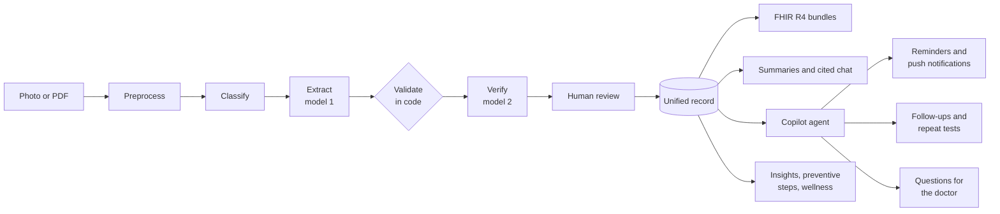

<div align="center">


**Your family's medical paperwork, read twice, checked by code and confirmed by you, then explained in your own language.**

[](https://github.com/prasanthselam-arch/health-copilot/actions/workflows/ci.yml)
[](LICENSE)


[**Live demo**](https://healthcopilot.duckdns.org) · [**Demo video**](docs/submission/Health-Copilot-demo.mp4) · [**Full documentation**](DOCUMENT.md) · [Architecture](docs/architecture.md) · [Slides](docs/slides.pdf) · [Deck (PPTX)](docs/submission/Health-Copilot-demo.pptx) · [Demo script](docs/demo_script.md)

</div>

---

Photograph a handwritten prescription, a Telugu lab report or a ten-page discharge summary. Health Copilot turns it
into a verified, unified health record. It explains every abnormal value in plain language, answers questions with
citations to the source documents, and exports everything as ABDM-ready FHIR R4.

Then it keeps the family on track. A copilot schedules each medicine's reminders from the prescription and stops them
when the course ends, turns "review after 1 month" into a dated follow-up, spots a father's sugar rising across three
reports and prompts the overdue HbA1c, and drafts the questions for the next visit. Everything it does is shown, and
can be kept, edited or undone. Insights, preventive steps and a wellness plan come from each person's own results, and
everything works in English and 12 Indian languages, by voice too.

*Built for the Altrix Labs hackathon "AI-Powered Personal Health Copilot" (Round 2: the engagement layer).*

**Try it:** [healthcopilot.duckdns.org](https://healthcopilot.duckdns.org), sign in as `demo@healthcopilot.in` / `demo12345`.


## What sets it apart

| | |
|---|---|
| **A copilot you stay in charge of** | Confirming a prescription schedules every medicine at its own times (before food, bedtime, 1-0-1) and ends each reminder with the course. Follow-ups in the doctor's notes become dated visits and tests, overdue ones are flagged daily, and three questions are drafted for the next visit. Every action lists its source record and can be kept, edited or undone. |
| **Insights with receipts** | Risk flags (out of range in consecutive reports, wrong-way trends, combinations such as sugar with LDL or triglycerides with low HDL), repeat tests due and age-based screenings are computed in code, and each cites the exact results and dates. They're worded for discussion with a doctor, never as a diagnosis. |
| **Reminders that reach you** | Web Push notifications with **Taken** and **Snooze** buttons, in each family member's language, plus visit and test notices. Adherence over 7 days and a printable doctor visit sheet. |
| **12 Indian languages + English** | Hindi, Bengali, Marathi, Telugu, Tamil, Gujarati, Urdu (right to left), Kannada, Odia, Malayalam, Punjabi and Assamese across the interface, summaries, chat, voice, reminders and notifications. Each family member has their own language. |
| **Two readers, one referee** | One model extracts, a *different* model re-reads the page, steered by the fields the validators found suspicious, and code arbitrates. Nothing is saved until a person confirms it on a side-by-side review screen. |
| **AI reads, code decides** | High, Low and Critical flags, unit conversions, LOINC and ICD-10 codes and medicine schedules come from a curated knowledge base (60 lab tests, 213 Indian drug brands, dosage shorthand such as `1-0-1 AC`), never from the model. |
| **Measured, not claimed** | Re-scorable eval suite: **100% of 477 fields** correct with verification, 99.8% in a single pass, across printed, handwritten, phone-photo, PDF and four Indian scripts. See [`eval/report.md`](eval/report.md). |
| **Safe by construction** | Summaries can only use numbers that are in the record; dosing advice and diagnoses are blocked; critical values and emergency symptoms escalate to a doctor or 112. Models never see names, phone numbers or ABHA IDs. |
| **ABDM-native** | Every document becomes an NRCeS-profile FHIR R4 bundle, readable in the app with the JSON one click away. Includes a mock ABHA link with OTP, a consent artefact and import from a mock Health Information Provider. |
| **Zero-cost production** | Runs live on the AWS free tier: one EC2 instance with Docker, Caddy for HTTPS and a free DuckDNS name, always on so reminders fire on time. A Render blueprint (free) is included as an alternative. |

<table>
  <tr>
    <td><br><sub>Side-by-side review with confidence and verifier changes</sub></td>
    <td><br><sub>Plain-language summary in Hindi</sub></td>
  </tr>
  <tr>
    <td><br><sub>Trends against reference ranges</sub></td>
    <td><br><sub>Cited answers in Telugu, with voice</sub></td>
  </tr>
</table>

## How it works



**Stack:** FastAPI · SQLModel · Gemini (OpenAI optional) with per-role model fallback chains · React 19 · Vite ·
TypeScript · Tailwind CSS 4 · TanStack Query · i18next · Docker · GitHub Actions.


Family accounts hold several profiles, each with its own records. Sign in with your email or mobile number; sign-up is
verified by email, and every new device and password change triggers a security alert.

On a phone it gets a bottom tab bar and installs to the home screen like an app. Uploads can be deleted before
they're reviewed, and nothing reaches the record until you confirm it.

<br clear="right">

## Run it

```bash
git clone https://github.com/prasanthselam-arch/health-copilot.git && cd health-copilot
./run.sh setup     # installs what's missing and creates backend/.env: add GEMINI_API_KEY there
./run.sh start     # http://localhost:5173
```

To load the demo family (a father with rising sugar, a mother on thyroid and iron tablets, and a new fever
prescription), run `cd backend && .venv/bin/python -m app.demo`, then sign in as `demo@healthcopilot.in` with the
password `demo12345`.

To deploy your own copy on the AWS free tier (or Render), follow [DOCUMENT.md § 6](DOCUMENT.md#6-deploying-aws-the-live-site-or-render).

## Documentation

[DOCUMENT.md](DOCUMENT.md) covers everything else:

- [features](DOCUMENT.md#1-features-in-detail) and the [pipeline](DOCUMENT.md#2-how-the-pipeline-works);
- [local setup](DOCUMENT.md#3-running-locally), including Docker and corporate proxies;
- [accounts and email](DOCUMENT.md#4-accounts-email-codes-and-notifications);
- [deployment](DOCUMENT.md#6-deploying-aws-the-live-site-or-render) and [configuration](DOCUMENT.md#7-configuration-reference);
- [tests](DOCUMENT.md#8-tests-and-evaluation), the [project layout](DOCUMENT.md#9-project-layout) and
  [safety and privacy](DOCUMENT.md#10-safety-privacy-and-security).

> [!IMPORTANT]
> Health Copilot is a prototype, not a medical device. It does not diagnose or advise on treatment. Always consult a
> qualified doctor.

## Authors

| | Role |
|---|---|
| **Prasanth Selam** · [prasanth.selam@gmail.com](mailto:prasanth.selam@gmail.com) · [@prasanthselam-arch](https://github.com/prasanthselam-arch) | Lead developer |

## License

Copyright 2026 Prasanth Selam.

Licensed under the [Apache License, Version 2.0](LICENSE). Any redistribution, modified or not, must keep the
[LICENSE](LICENSE) and [NOTICE](NOTICE) files, including the authors' copyright and attribution, and must state what
was changed. The license grants no rights to the project's name or the authors' names. Bundled fonts and data
sources keep their own licenses; see [credits](DOCUMENT.md#11-credits).
